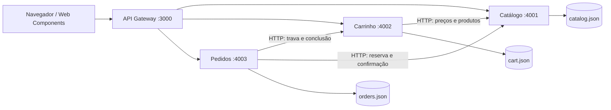

# Nexo Commerce

E-commerce de demonstração, em português, desenvolvido com **microsserviços** e **componentes de software reutilizáveis**. Catálogo, carrinho, estoque e pedidos funcionam de ponta a ponta. Não realiza cobranças, não envia e-mails e não despacha produtos.

## Executar

Requisito: **Node.js 22 ou superior**. O projeto não usa pacotes externos e dispensa `npm install`.

```powershell
npm start
```

Abra **http://127.0.0.1:3000** (ou `http://localhost:3000`). O comando inicia quatro processos independentes. `Ctrl+C` encerra todos. Os dados e a chave da sessão local são criados automaticamente em `data/`, que não deve ser versionada. Ao reiniciar, os carrinhos e pedidos permanecem disponíveis no mesmo navegador e no mesmo endereço.

Para configurar portas ou chaves, copie `.env.example` para `.env` e edite os valores antes de iniciar. `npm start` carrega o arquivo automaticamente. As variáveis `PORT`, `CATALOG_PORT`, `CART_PORT` e `ORDERS_PORT` permitem alterar as portas.

## Funcionalidades

- Catálogo com oito produtos, detalhes, estoque, avaliações ilustrativas e preços em reais.
- Busca sem distinção de acentos, categorias, ordenação por preço, nome e avaliação.
- Filtros de preço, ofertas e favoritos salvos no navegador.
- Carrinho persistente por sessão, controle de quantidades e remoção de itens.
- Checkout com validação de dados e endereço; Pix e cartão **simulados**.
- Frete grátis a partir de R$ 299 em produtos; abaixo disso, R$ 19,90.
- Desconto de 5% no subtotal para Pix, calculado no servidor em centavos.
- Histórico de pedidos da sessão, persistência após reinício e proteção contra confirmação duplicada.
- Interface responsiva, navegação por teclado, diálogos acessíveis e ilustrações SVG locais.

## 1. Microsserviços



| Serviço | Responsabilidade | Dados próprios |
| --- | --- | --- |
| Gateway | Servir a interface, identificar sessões, validar origem e encaminhar APIs | Cookie assinado; sem banco de domínio |
| Catálogo | Produtos, preços, estoque e reservas atômicas | `data/catalog.json` |
| Carrinho | Itens por sessão e bloqueio durante checkout | `data/cart.json` |
| Pedidos | Validação, cálculo de totais, histórico e orquestração do checkout | `data/orders.json` |

São processos separados com comunicação HTTP: um serviço não importa a implementação de outro nem acessa seu arquivo de dados. O diretório local é compartilhado apenas por conveniência; no Docker, os volumes são separados. O código comum contém infraestrutura, não regras de negócio.

### Fluxo de compra

1. O gateway identifica a sessão usando um cookie `HttpOnly`, `SameSite=Lax` e assinado com HMAC.
2. O serviço de pedidos recebe uma chave de idempotência e valida os dados.
3. O carrinho é bloqueado para impedir alterações durante a confirmação.
4. O catálogo verifica e reserva todos os itens numa única mutação; preços enviados pelo cliente são ignorados.
5. Pedidos calcula frete e desconto, persiste a compra e confirma a reserva.
6. O carrinho é esvaziado e liberado. O pedido é devolvido ao navegador.
7. Se houver falha antes de persistir o pedido, a compensação libera a reserva e o carrinho. Se a compra já foi persistida, uma repetição com a mesma chave retoma a conclusão sem cobrar ou baixar estoque novamente.

Esse fluxo demonstra **orquestração de saga**, **idempotência** e **encapsulamento dos dados**. Os serviços internos exigem uma credencial compartilhada; o gateway aceita apenas rotas públicas explícitas.

## 2. Componentes de software

Os componentes visuais usam o padrão nativo **Web Components / Custom Elements**, com módulos ES e eventos. Não exigem React nem um empacotador.

| Componente | Arquivo | Contrato reutilizável |
| --- | --- | --- |
| `<product-card>` | `web/components/product-card.js` | Propriedades `product`, `saved`; eventos `product:add`, `product:detail`, `product:favorite` |
| `<cart-drawer>` | `web/components/cart-drawer.js` | Propriedade `cart`; métodos `open()`, `close()`; eventos `cart:quantity`, `cart:checkout` |
| `<checkout-modal>` | `web/components/checkout-modal.js` | Método `open(cart)`; evento `order:created` |
| `<store-toast>` | `web/components/toast.js` | Método `show(message, type)`; região de anúncio acessível |

Componentes adicionais de infraestrutura: cliente HTTP em `web/lib/api.js`, ícones e formatação em `web/lib/icons.js`, ilustrações em `web/lib/art.js`, servidor HTTP em `shared/http.mjs` e repositório atômico de dados em `shared/store.mjs`.

A aplicação `web/app.js` coordena estado e eventos. A folha de estilos compartilhada é intencional: estes componentes usam DOM normal para compartilhar os tokens visuais da loja.

## APIs públicas

Todas as rotas passam pelo gateway. Campos monetários são inteiros em **centavos**. Respostas de erro têm o formato `{ "error": "mensagem" }`.

| Método | Rota | Uso |
| --- | --- | --- |
| GET | `/api/products?q=orbit&category=Áudio` | Catálogo e filtros opcionais |
| GET | `/api/products/:id` | Detalhes e estoque |
| GET | `/api/cart` | Carrinho da sessão e subtotal |
| POST | `/api/cart/items` | Adicionar `{ "productId": "headphone-orbit", "quantity": 1 }` |
| PATCH | `/api/cart/items/:id` | Definir `{ "quantity": 2 }` |
| DELETE | `/api/cart/items/:id` | Remover item |
| GET | `/api/orders` | Pedidos da sessão |
| POST | `/api/orders` | Criar pedido; exige `Idempotency-Key` no cabeçalho |
| GET | `/api/health` | Disponibilidade dos serviços |

Exemplo de corpo para um pedido, depois de adicionar produtos ao carrinho:

```json
{
  "customer": { "name": "Cliente Exemplo", "email": "cliente@example.com" },
  "address": { "zip": "01001-000", "street": "Praça da Sé", "number": "100", "city": "São Paulo", "state": "SP" },
  "paymentMethod": "pix"
}
```

O cliente deve conservar o cookie da sessão e enviar a mesma chave de idempotência ao repetir uma confirmação cujo resultado seja desconhecido. O frontend faz isso automaticamente usando `sessionStorage`.

## Docker

Com Docker Engine e Compose disponíveis:

```powershell
Copy-Item .env.example .env
# Edite SERVICE_TOKEN em .env.
docker compose up --build
```

Acesse http://localhost:3000. Só o gateway publica uma porta no host. Cada serviço possui um contêiner, e cada serviço de domínio possui um volume próprio. Para encerrar sem apagar os dados: `docker compose down`.

## Verificação

```powershell
npm run check
npm test
```

Os testes iniciam quatro processos reais em portas livres, usam um diretório temporário e não alteram os dados da loja. Cobrem isolamento de sessões, validações, preços confiáveis, desconto, frete, concorrência de estoque, idempotência, compensação, autenticação interna, bloqueio de origem externa e persistência ao reiniciar pedidos.

## Escopo acadêmico

Este projeto demonstra uma arquitetura funcional. O armazenamento JSON com troca atômica de arquivo atende uma instância por serviço e um volume pequeno de dados. Antes de uso comercial, seriam necessários bancos transacionais separados por domínio, autenticação de clientes, recuperação automática de sagas interrompidas, observabilidade, limites de tráfego e integração com provedores reais de pagamento e entrega.

Se um processo for interrompido no meio do checkout, a mesma sessão e chave de idempotência permitem retomar a intenção persistida. Não há um worker periódico para recuperar pedidos abandonados: um carrinho pode permanecer bloqueado até a retomada. Cookies e histórico são locais ao navegador; não existe conta de usuário nem sincronização entre dispositivos.

Para servir com HTTPS em infraestrutura externa, configure `COOKIE_SECURE=true`, `SESSION_SECRET` estável e URLs internas dos serviços. O ambiente Docker foi preparado no código; sua execução requer Docker instalado.
